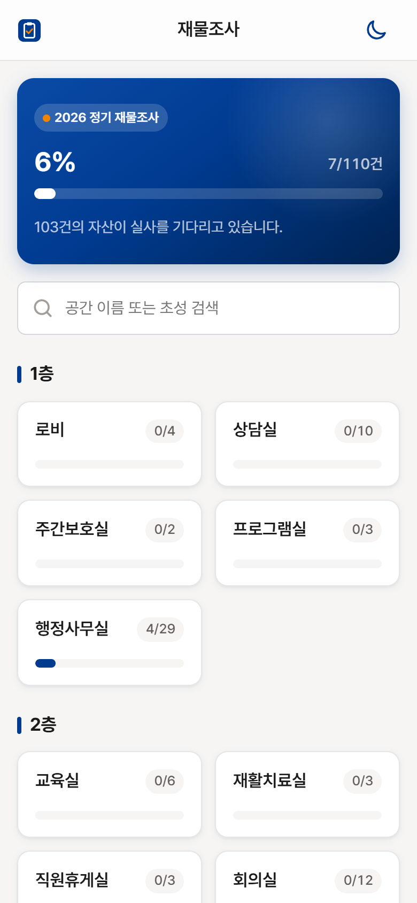
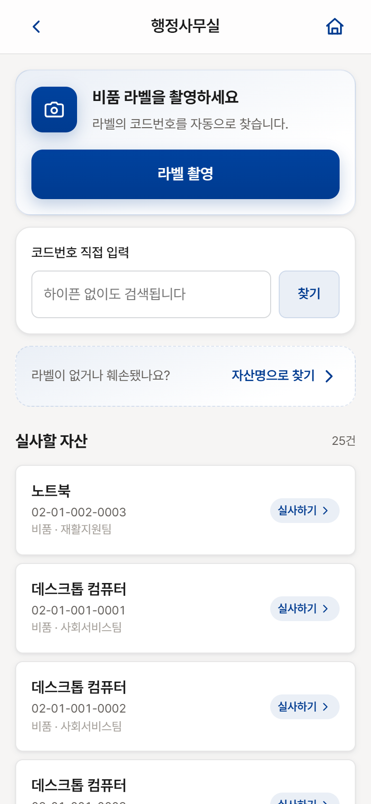
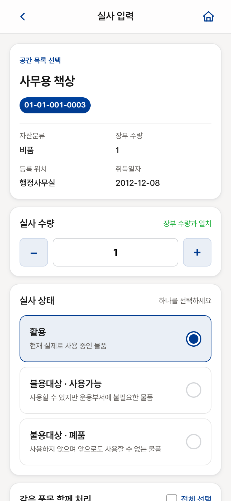
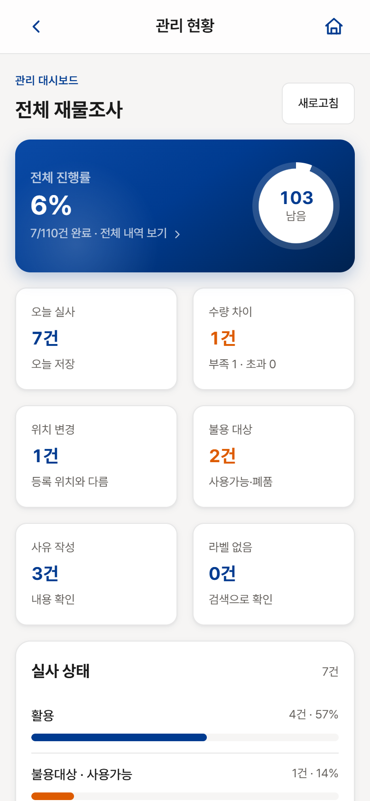
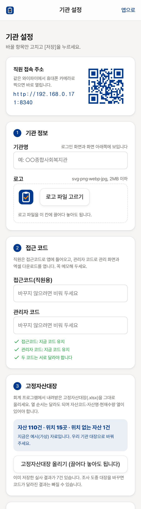

# 사회복지시설 재물조사: 휴대폰으로 하는 비품 실사

  
  
  
  

사회복지시설의 재물조사를 종이 목록 대신 **휴대폰으로** 하고, 결과를 **재물조사표 엑셀**로 바로 내려받는 웹앱(프로그램)입니다.

기관 PC 한 대에 설치하면, 같은 와이파이에 연결된 직원 휴대폰의 인터넷 브라우저로 접속해서 씁니다.
휴대폰에 앱을 따로 설치하거나 회원가입을 할 필요가 없고, 실사 자료는 **설치한 기관 PC 안에만** 저장됩니다.

## 달라지는 점

| 기존 | 웹앱 사용 시 |
| --- | --- |
| 자산 목록을 출력해 들고 다니며 하나씩 표시 | 휴대폰으로 방(공간)을 고르고 비품 라벨을 찍으면 자산을 찾아 줍니다 |
| 조사가 끝난 뒤 결과를 엑셀에 다시 옮겨 적기 | 저장하는 즉시 모이고, 재물조사표 엑셀을 버튼 한 번으로 내려받습니다 |
| 누가 어디까지 했는지 확인하기 어려움 | 관리 화면에서 공간별 진행률·수량 차이·불용 대상을 한눈에 봅니다 |
| 여러 명이 나눠 조사하면 결과를 합치기 번거로움 | 여러 직원이 동시에 조사해도 한곳에 모이고, 누가 저장했는지 기록이 남습니다 |

## 주요 기능

- **라벨 촬영으로 자산 찾기**: 비품 라벨을 찍으면 자산코드를 읽어 찾아 줍니다. 라벨이 없거나 훼손됐으면 자산명·초성(예: ㅁㄴㅌ)으로 찾습니다.
- **수량·상태 입력**: 실사 수량과 상태(활용 / 불용대상·사용가능 / 불용대상·폐품)를 고르고, 장부와 다르면 사유를 남깁니다. 위치가 바뀐 자산은 확인한 위치를 고릅니다.
- **같은 품목은 한꺼번에**: 같은 종류의 의자 10개처럼 일련번호만 다른 자산은 한 번에 처리합니다.
- **관리 화면**: 전체·공간별 진행률, 수량 차이, 위치 변경, 불용 대상을 모아 보고, 표에서 검색·정렬·일괄 수정을 합니다.
- **재물조사표 엑셀 출력**: 기관에서 쓰는 양식의 서식을 그대로 두고 실사 결과(조사일자·실사상태·과부족·사유)만 채웁니다.
- **실수 되돌리기와 기록**: 저장 직후 되돌릴 수 있고, 모든 저장·삭제는 지워지지 않는 기록으로 남습니다.
- **설치와 설정이 쉬움**: 설치 프로그램 하나로 설치하고, 기관명·로고·코드·자산 목록은 브라우저 화면에서 정합니다. 직원은 QR 코드를 찍어 바로 접속합니다.

## 준비물

- 항상 켜 둘 수 있는 **Windows 10 또는 11 PC** 1대 (서버 역할)
- 이 PC와 **같은 와이파이**에 연결된 직원 휴대폰
- 희망이음 ERP에서 내려받은 **고정자산대장 엑셀(.xlsx)**: 자산코드·자산명·현재수량 열이 있으면 됩니다
- (선택) 기관 로고 파일(png 또는 svg)

## 설치하기

1. 이 페이지 오른쪽의 **[Releases](../../releases/latest)** 에서 `inventory-count-버전-setup.exe` 를 내려받습니다.
2. 내려받은 파일을 실행하고 **다음 → 마침**을 누릅니다.
   - "Windows의 PC 보호" 창이 뜨면 **추가 정보 → 실행**을 누릅니다. 서명 인증서가 없는 프로그램이라 나오는 안내입니다.
   - 설치 중 나오는 세 가지 선택(바탕화면 바로가기, 방화벽 허용, PC를 켜면 자동 시작)은 켜 둔 채 진행하세요.
3. 설치가 끝나면 브라우저에 **처음 설정** 화면이 열립니다. 위에서부터 차례로 채우고 **[저장하고 시작하기]** 를 누릅니다.

| 순서 | 할 일 |
| --- | --- |
| 1. 기관 정보 | 기관명을 적고 로고 파일을 고릅니다 |
| 2. 접근 코드 | 직원용 접근코드와 관리자 코드를 정합니다(숫자 6자리 이상, 서로 다르게). **꼭 메모해 두세요** |
| 3. 고정자산대장 | 우리 기관 대장 엑셀을 올립니다. 자산 수와 위치 수를 바로 보여 주고, 형식이 틀리면 알려 줍니다 |
| 4. 공간 | 대장의 자산위치(방 이름)마다 층·건물을 적습니다 |
| 5. 재물조사표 양식 | 기관 양식이 있으면 올리고, 없으면 기본 양식을 씁니다 |
| 6. 백업 폴더 | 외장 드라이브나 NAS 폴더를 적어 두면 PC가 고장 나도 자료를 지킬 수 있습니다 |

저장하면 직원 접속용 **QR 코드**가 나옵니다. 인쇄해서 붙여 두면 직원은 휴대폰 카메라로 찍기만 하면 됩니다.

> 설치 프로그램을 쓸 수 없는 PC라면 `inventory-count-버전-portable.zip` 을 내려받아 압축을 풀고 `start.bat` 을 실행하세요.
> 자세한 방법은 [설치·운영 안내](docs/설치_운영_안내.md)에 있습니다.

## 사용하기

**직원 (휴대폰)**

1. QR 코드를 찍어 접속하고, 이름(선택)과 접근코드를 입력합니다.
2. 조사할 방(공간)을 고릅니다.
3. 비품 라벨을 찍거나 목록에서 자산을 고릅니다.
4. 수량과 상태를 고르고 저장합니다. 장부와 다르면 사유를 적습니다.

**관리자 (PC 또는 휴대폰)**

1. 화면 맨 아래의 **관리**를 누르고 관리자 코드를 입력합니다.
2. 진행률과 수량 차이·불용 대상을 확인하고, 필요하면 표에서 고칩니다.
3. **[전체 재물조사표 내려받기]** 로 엑셀을 받습니다.
4. 기관명·로고·자산대장을 바꾸거나 백업할 때는 **[기관 설정 · 백업]** 을 엽니다.

## 자주 묻는 질문

**인터넷이 꼭 있어야 하나요?**
아니요. 설치가 끝나면 기관 안의 와이파이만 있으면 됩니다. 글꼴과 라벨 인식 기능도 프로그램에 들어 있습니다.

**실사 자료는 어디에 저장되나요?**
설치한 PC의 프로그램 폴더(기본 `C:\InventoryCount\data`)에만 저장됩니다. 외부 서버로 보내지 않습니다.

**비용이 드나요?**
프로그램에는 회원가입이나 사용료가 없습니다. 라벨 인식을 더 정확하게 하려고 Google Vision 키를 따로 넣는 경우에만, 사용한 만큼 Google에 요금이 나갑니다(선택 기능, 넣지 않아도 됩니다).

**휴대폰에 앱을 설치해야 하나요?**
아니요. 휴대폰 인터넷 브라우저로 접속합니다. 브라우저 메뉴의 "홈 화면에 추가"를 누르면 앱처럼 쓸 수 있습니다.

**우리 기관 고정자산대장은 양식이 조금 달라요.**
열의 순서는 달라도 됩니다. 첫 줄 근처에 `자산코드`·`자산명`·`현재수량` 머리글이 있으면 읽습니다. 대장을 올리면 설정 화면이 바로 검사해서 빠진 머리글을 알려 줍니다.

**여러 명이 동시에 조사해도 되나요?**
됩니다. 두 사람이 같은 자산을 동시에 고치면 나중에 저장한 사람에게 알려 줘서 덮어쓰지 않게 합니다.

**서버 PC가 꺼지면 어떻게 되나요?**
꺼져 있는 동안에는 접속할 수 없습니다. 설치할 때 "PC를 켜면 자동 시작"을 켜 두면, PC를 다시 켜는 것만으로 이어서 쓸 수 있습니다.

**연습으로 저장한 결과는 어떻게 지우나요?**
처음에는 예시(가상) 자산이 들어 있습니다. 연습한 뒤 **[기관 설정 · 백업] → 실사 결과 모두 지우기**를 누르면 백업한 다음 지웁니다.

**새 버전이 나오면요?**
새 `setup.exe` 를 실행하기만 하면 됩니다. 설치 프로그램이 먼저 백업하고, 설정과 실사 자료는 그대로 둔 채 프로그램만 바꿉니다.

**외부(인터넷)에서도 접속할 수 있나요?**
기본은 기관 와이파이 안에서만 쓰도록 되어 있습니다. 꼭 필요하면 Cloudflare 터널로 외부 주소를 열 수 있습니다. 이 경우 [설치·운영 안내](docs/설치_운영_안내.md)의 "외부에서 접속해야 할 때"를 따르세요.

## 안전하게 쓰려면

- 접근코드와 관리자 코드는 숫자 6자리 이상으로 정하고, 관리자 코드는 담당자만 알게 하세요. 코드를 10번 틀리면 그 기기는 10분 동안 잠깁니다.
- 기관 와이파이 안의 통신은 암호화되지 않습니다(HTTP). 손님용 공용 와이파이보다는 직원용 와이파이에서 쓰세요.
- 백업 폴더는 서버 PC가 아닌 외장 드라이브나 NAS로 정해 두는 것을 권장합니다.

## 누가 쓸 수 있나요 (라이선스)

이 웹앱은 **사회복지시설 등 비영리 기관**이 무료로 쓸 수 있도록 공개합니다.

- **쓸 수 있는 곳**: 사회복지법인·사회복지시설, 국가·지방자치단체·공공기관이 운영하거나 위탁한 사회복지시설과 복지 관련 기관, 그 밖의 비영리법인·비영리민간단체
- **할 수 있는 일**: 기관 업무에 설치해 쓰기, 고쳐 쓰기, 다른 비영리 기관에 무료로 나누어 주기(기관을 위해 외부 업체가 설치·관리를 대신하는 것도 포함)
- **할 수 없는 일**: 영리 목적 사용, 판매·대여, 이용료를 받는 서비스로 제공하기

정확한 조건은 [LICENSE](LICENSE)를 따릅니다. 그 밖의 용도로 쓰려면 Issues로 문의해 주세요.

## 더 알아보기

- [설치·운영 안내](docs/설치_운영_안내.md) — 설치, 설정 변경, 백업, 업데이트, 문제 해결을 단계별로 설명합니다
- [개발자 안내](docs/개발자_안내.md) — 코드 구조, 패키지 만들기, 디자인 시스템 규칙
- [오픈소스 구성요소와 라이선스](THIRD_PARTY_NOTICES.md)

문의나 개선 제안은 이 저장소의 **Issues**에 남겨 주세요.
